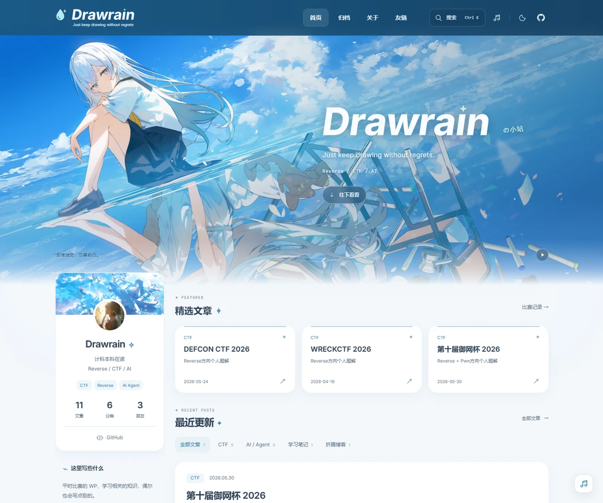

# Drawrain's Blog

记录 Reverse、CTF、AI，以及学习中遇到的一些事情。

[访问博客](https://drawrain.me/) · [文章归档](https://drawrain.me/archive/) · [关于我](https://drawrain.me/about/)



从 [Fuwari](https://github.com/saicaca/fuwari) 起步，保留 Astro 的静态内容架构，重新设计了页面、排版和交互。现在使用浅色雾蓝与白色卡片，搭配自己的雨滴字标和二次元插画，也保留了暗色模式。

## 当前功能

- 首页精选、分类筛选和加载更多；文章以文字卡片展示。
- 独立归档、分类与标签筛选，以及按发文日期生成的写作日历。
- 文章目录与当前章节高亮、阅读进度、代码复制、行号、语言标记、公式和图片放大。
- 文章系列与相邻文章导航。
- `Ctrl / Cmd + K` 快捷搜索；生产构建使用 Pagefind 正文索引。
- 全站音乐播放器，站内切换页面时保留播放状态。
- 关于页的技术栈、时间线与联系方式；友链预览和一键复制站点信息。
- 共享矢量字标、浏览器图标、构建时生成的分享卡片、Sitemap 和文章结构化数据。
- 首次进入首页的短开场、可暂停的背景点缀，以及适配减少动态效果偏好的微交互。

## 本地运行

使用 Node.js 22+ 和 pnpm 9.14.4。当前本地校验环境为 Node.js 24.11.0。

```sh
git clone https://github.com/Drawrain39/Blog.git
cd Blog
pnpm install --frozen-lockfile
pnpm dev
```

开发地址默认为 `http://localhost:4321/`，端口占用时以终端输出为准。

| 命令 | 用途 |
| --- | --- |
| `pnpm dev` | 启动开发服务器 |
| `pnpm check` | 检查 Astro、Svelte 和 TypeScript |
| `pnpm build` | 生成静态页面、图片、分享卡片和搜索索引到 `dist/` |
| `pnpm preview` | 预览已有的生产构建 |
| `pnpm new-post my-post` | 新建 `src/content/posts/my-post.md` |

主要技术：Astro 5、Svelte 5、TypeScript、Tailwind CSS 3、Expressive Code、Pagefind、Sharp。

## 写文章

```sh
pnpm new-post my-post
```

编辑生成的 Markdown 文件。常用 Frontmatter 示例：

```yaml
---
title: 一次 Reverse 题目的分析记录
published: 2026-11-08
description: 从入口函数到校验逻辑，记录分析过程。
category: CTF
tags: [Reverse, Writeup]
draft: false
featured: true
featuredOrder: 1
hideInHome: false
---
```

| 字段 | 作用 |
| --- | --- |
| `title`、`published` | 必填的文章标题和发布日期 |
| `updated` | 可选的更新日期 |
| `draft` | 草稿；开发时可预览，生产构建中不发布 |
| `featured`、`featuredOrder` | 首页最多展示三篇精选，按排序值升序排列 |
| `hideInHome` | 不展示在首页，仍保留在归档与文章页 |
| `description` | 摘要；未填写时列表使用正文摘要 |
| `category`、`tags` | 分类和标签 |
| `series`、`seriesOrder` | 同名系列及系列内的顺序 |
| `image` | 可选的文章内页封面；首页卡片不显示封面 |
| `lang` | 覆盖站点默认语言 |

完整字段定义见 [src/content/config.ts](src/content/config.ts)。正文支持 Markdown、KaTeX 公式、提示块和增强代码块。

## 调整外观和内容

当前页面有独立的组件与样式入口。部分 Fuwari 配置保留用于兼容，修改界面时应以实际渲染组件为准。

| 想改什么 | 修改位置 |
| --- | --- |
| 首页壁纸、文案、个人侧栏 | [src/pages/[...page].astro](src/pages/%5B...page%5D.astro) |
| 全站配色、字体、尺寸和精选样式 | [src/styles/theme.css](src/styles/theme.css) |
| 导航、主题按钮与页脚 | [Navbar.astro](src/components/Navbar.astro)、[Footer.astro](src/components/Footer.astro) |
| 作者、头像、目录、代码主题与音乐 | [src/config.ts](src/config.ts) |
| 关于页的简介、技术栈、时间线与联系方式 | [src/pages/about.astro](src/pages/about.astro) |
| 友链列表 | [src/constants/friends.ts](src/constants/friends.ts) |
| 友链申请与本站复制信息 | [src/pages/friends.astro](src/pages/friends.astro) |
| 文章阅读排版 | [editorial-article.css](src/styles/editorial-article.css)、[文章页](src/pages/posts/%5B...slug%5D.astro) |
| 雨滴字标和浏览器图标 | [brand.ts](src/utils/brand.ts)、[Brand.astro](src/components/Brand.astro)、[favicon.svg.ts](src/pages/favicon.svg.ts) |
| 短开场与音乐播放器 | [OpeningSplash.astro](src/components/OpeningSplash.astro)、[PersistentMusic.astro](src/components/PersistentMusic.astro) |
| 页面标题、SEO 与分享图引用 | [src/layouts/Layout.astro](src/layouts/Layout.astro) |
| 分享卡片生成 | [src/pages/og/[...slug].png.ts](src/pages/og/%5B...slug%5D.png.ts) |
| 正式域名与构建设置 | [astro.config.mjs](astro.config.mjs) |

图片放在 `src/assets/images/`，通过 Astro 图片组件生成响应式 WebP。首页按实际裁切尺寸选择图片，最大保留原图的 1920px 宽度。

### 搜索

开发模式按标题、摘要、分类和标签匹配。`pnpm build` 会额外生成 Pagefind 正文索引；使用 `pnpm preview` 检查完整搜索效果。索引规则见 [pagefind.yml](pagefind.yml)。

### 音乐

歌曲信息和默认音源在 `src/config.ts` 的 `musicConfig` 中。音源可通过构建环境变量 `PUBLIC_MUSIC_URL` 覆盖，修改后重新构建。播放器需要手动点击播放。

## 构建与部署

```sh
pnpm check
pnpm build
pnpm preview
```

部署时使用构建命令 `pnpm build`，发布目录为 `dist/`，包含 `pagefind/` 搜索索引和 `og/` 分享图片。项目使用静态输出，可交给支持静态网站的托管平台。

正式域名目前为 `https://drawrain.me/`。更换域名时，更新 `astro.config.mjs` 的 `site`，并同步检查友链页中用于复制的站点信息。

## 来源与许可

项目基于 [saicaca/Fuwari](https://github.com/saicaca/fuwari) 二次开发，保留上游 MIT 版权声明。代码许可证见 [LICENSE](LICENSE)。
