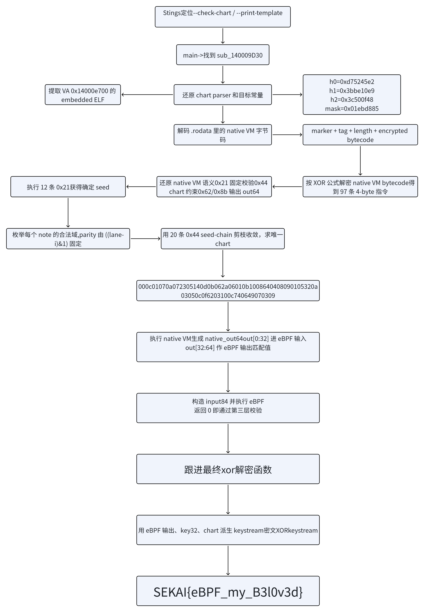

# Reverse

## Untitled Encore \| SOLVED \| ing \-Drawrain

一道VM

搓一个程序逆向执行一览




check\-chart，print\-template跟步检查定位

```C++
// Hidden C++ exception states: #wind=4
void **__fastcall sub_140009D30(void **Src, __int64 a2)
{
  unsigned __int64 i; // rcx
  unsigned __int64 j; // rax
  _OWORD *v6; // rax
  _OWORD *v7; // rax
  _OWORD *v8; // rax
  __int64 v9; // rdx
  _BYTE *v10; // rcx
  void *v11; // rcx
  void *Block; // [rsp+38h] [rbp-C8h] BYREF
  __int128 v14; // [rsp+40h] [rbp-C0h]
  void *v15[2]; // [rsp+50h] [rbp-B0h] BYREF
  char *v16; // [rsp+60h] [rbp-A0h]
  void **Src_1; // [rsp+68h] [rbp-98h]
  _BYTE v18[24]; // [rsp+70h] [rbp-90h] BYREF
  _BYTE v19[24]; // [rsp+88h] [rbp-78h] BYREF
  _DWORD v20[8]; // [rsp+A0h] [rbp-60h] BYREF
  _BYTE v21[32]; // [rsp+C0h] [rbp-40h] BYREF
  _OWORD Buf1[2]; // [rsp+E0h] [rbp-20h] BYREF
  _OWORD v23[2]; // [rsp+100h] [rbp+0h] BYREF
  _OWORD v24[2]; // [rsp+120h] [rbp+20h] BYREF
  _OWORD Buf2[2]; // [rsp+140h] [rbp+40h] BYREF

  Src_1 = Src;
  sub_1400031F0(v20);
  if ( v20[0] != -682474014 || *(_QWORD *)&v20[1] != 0x3C500F483BBE10E9LL || v20[3] != 32233605 )
LABEL_23:
    sub_1400062A0();
  for ( i = 0; i < 0xA; i += 2LL )
  {
    if ( *(_WORD *)((char *)&v20[4] + i) != *(_WORD *)((char *)&unk_14000F2E8 + i) )
      goto LABEL_23;
  }
  for ( j = 0; j < 6; j += 2LL )
  {
    if ( *(_WORD *)((char *)&v20[6] + j + 2) != *(_WORD *)((char *)&unk_14000F2F4 + j) )
      goto LABEL_23;
  }
  sub_140002E20(v21, 0x140000000uLL);
  v15[0] = (void *)sub_1400013D0(3000);
  v16 = (char *)v15[0] + 3000;
  memmove(v15[0], &unk_14000E700, 0xBB8u);
  v15[1] = (char *)v15[0] + 3000;
  sub_140006BF0(v18, v15);
  v6 = (_OWORD *)sub_140005AB0(v20, v19, a2);
  v24[0] = *v6;
  v24[1] = v6[1];
  Buf2[0] = v6[2];
  Buf2[1] = v6[3];
  sub_140006810(&Block, a2, v24);
  v7 = (_OWORD *)sub_1400085C0(v23);
  Buf1[0] = *v7;
  Buf1[1] = v7[1];
  if ( memcmp(Buf1, Buf2, 0x20u) )
    sub_1400062A0();
  v8 = (_OWORD *)sub_140004400(v20, a2);
  v23[0] = *v8;
  v23[1] = v8[1];
  sub_140003A10(Src, Buf1, v23, a2);
  v10 = Block;
  if ( Block )
  {
    if ( *((_QWORD *)&v14 + 1) - (_QWORD)Block >= 0x1000u )
    {
      v10 = (_BYTE *)*((_QWORD *)Block - 1);
      if ( (unsigned __int64)((_BYTE *)Block - v10 - 8) > 0x1F )
        invoke_watson(0, 0, 0, 0, 0);
    }
    j_j_free(v10);
    Block = 0;
    v14 = 0;
  }
  sub_140002E20(v19, v9);
  sub_140002E90(v18);
  v11 = v15[0];
  if ( v15[0] )
  {
    if ( (unsigned __int64)(v16 - (char *)v15[0]) >= 0x1000 )
    {
      v11 = (void *)*((_QWORD *)v15[0] - 1);
      if ( (unsigned __int64)((char *)v15[0] - (char *)v11 - 8) > 0x1F )
        invoke_watson(0, 0, 0, 0, 0);
    }
    j_j_free(v11);
  }
  return Src;
}
```

无GUI校验入口，该函数为check\_chart\_and\_build\_flag

```C++
_DWORD *__fastcall sub_1400031F0(_DWORD *urimenenanak, _QWORD *a2, __int64 a3, __int64 a4)
{
  _QWORD *v4; // rsi
  int v6; // edi
  void **v7; // rbx
  _QWORD *v8; // rcx
  unsigned __int64 v9; // rdx
  void *v10; // rcx
  unsigned __int64 n0x14; // rdx
  int v12; // r12d
  int v13; // r8d
  unsigned __int8 v14; // r11
  unsigned __int8 v15; // r10
  bool v16; // r15
  bool v17; // r14
  int v18; // r9d
  int v19; // esi
  BOOL v20; // edi
  int v21; // ebx
  int v22; // r8d
  __int16 v23; // r12
  int v24; // r15d
  char v26; // [rsp+30h] [rbp-39h] BYREF
  unsigned __int8 v27; // [rsp+31h] [rbp-38h] BYREF
  bool v28[2]; // [rsp+32h] [rbp-37h] BYREF
  int n3; // [rsp+34h] [rbp-35h]
  unsigned __int64 n0x14_1; // [rsp+38h] [rbp-31h]
  __int64 v31; // [rsp+40h] [rbp-29h]
  void *Block[2]; // [rsp+48h] [rbp-21h] BYREF
  void *v33; // [rsp+58h] [rbp-11h]
  float v35; // [rsp+E0h] [rbp+77h] BYREF
  char v36; // [rsp+E8h] [rbp+7Fh] BYREF

  v4 = a2;
  v6 = 0;
  n3 = 0;
  if ( a2[1] - *a2 != 40 )
    sub_1400062A0();
  urimenenanak[3] = 0;
  *((_QWORD *)urimenenanak + 2) = 0;
  *((_WORD *)urimenenanak + 12) = 0;
  *(_DWORD *)((char *)urimenenanak + 26) = 0;
  *((_WORD *)urimenenanak + 15) = 0;
  v7 = (void **)(urimenenanak + 8);
  *((_QWORD *)urimenenanak + 4) = 0;
  *((_QWORD *)urimenenanak + 5) = 0;
  *((_QWORD *)urimenenanak + 6) = 0;
  qmemcpy(urimenenanak, "urimenenanak", 12);
  LOBYTE(a4) = 65;
  sub_140003830(Block, &unk_14000F408, 19, a4);
  n3 = 3;
  if ( v7 == Block )
  {
    v9 = (unsigned __int64)v33;
  }
  else
  {
    v8 = *v7;
    if ( *v7 )
    {
      if ( (unsigned __int64)((_BYTE *)v7[2] - (_BYTE *)v8) >= 0x1000 )
      {
        if ( (unsigned __int64)v8 - *(v8 - 1) - 8 > 0x1F )
          goto LABEL_13;
        v8 = (_QWORD *)*(v8 - 1);
      }
      j_j_free(v8);
    }
    *v7 = Block[0];
    v7[1] = Block[1];
    v7[2] = v33;
    *(_OWORD *)Block = 0;
    v9 = 0;
    v33 = 0;
  }
  v10 = Block[0];
  if ( Block[0] )
  {
    if ( v9 - (unsigned __int64)Block[0] >= 0x1000 )
    {
      v10 = (void *)*((_QWORD *)Block[0] - 1);
      if ( (unsigned __int64)((char *)Block[0] - (char *)v10 - 8) > 0x1F )
LABEL_13:
        invoke_watson(0, 0, 0, 0, 0);
    }
    j_j_free(v10);
  }
  n0x14 = 0;
  n0x14_1 = 0;
  do
  {
    v12 = *(unsigned __int8 *)(*v4 + 2 * n0x14);
    v13 = *(unsigned __int8 *)(*v4 + 2 * n0x14 + 1);
    LOBYTE(v35) = v13;
    v26 = v13;
    v14 = v12 & 7;
    v36 = v12 & 7;
    v15 = ((unsigned __int8)v12 >> 3) & 3;
    v27 = v15;
    v16 = (v12 & 0x20) != 0;
    v28[0] = v16;
    v17 = (v12 & 0x40) != 0;
    if ( (v12 & 7u) > 4
      || (((unsigned __int8)v12 >> 3) & 3) == 3
      || (unsigned __int8)(v13 - 3) > 0xDu
      || ((v14 - (_BYTE)n0x14) & 1) != v17 )
    {
      sub_1400062A0();
    }
    v18 = v13;
    v19 = v14;
    v31 = ((v14 ^ (unsigned __int8)n0x14) & 3u) + v6 + 120 * v13;
    v20 = v16;
    v21 = v15;
    v22 = __ROL4__(*urimenenanak + 73244475 * (v14 + 1) + n0x14_1 + 295559667 * v13, (v16 + 3 * (v15 + 1)) & 0x1F);
    *urimenenanak = v22;
    urimenenanak[1] ^= __ROL4__((unsigned __int16)v31 | ((v12 | (v18 << 8)) << 16), (n0x14_1 + v14) & 0x1F);
    urimenenanak[2] += (v22 ^ urimenenanak[1]) + (v16 + 3) * (v15 + 17);
    v23 = LOBYTE(v35);
    *((_WORD *)urimenenanak + v14 + 8) += LOBYTE(v35) + v17 + 3 * v15 + 5 * v16;
    *((_WORD *)urimenenanak + v15 + 13) += v23 + v14 + (n0x14_1 & 3);
    v24 = v31;
    urimenenanak[3] |= 1 << ((v14 + v15 + 4 * v14 + (unsigned int)v31 / 0x78) % 0x19);
    LOBYTE(v35) = v24;
    sub_140008080(urimenenanak + 8, &v35);
    LOBYTE(v35) = BYTE1(v24);
    sub_140008080(urimenenanak + 8, &v35);
    sub_140008080(urimenenanak + 8, &v36);
    sub_140008080(urimenenanak + 8, &v26);
    sub_140008080(urimenenanak + 8, &v27);
    sub_140008080(urimenenanak + 8, v28);
    v35 = (float)((float)(v23 & 3) * 0.125) + (float)v19;
    sub_140008180(urimenenanak + 8, LODWORD(v35));
    v35 = (float)((v21 + v20) % 3u) + 1.0;
    sub_140008180(urimenenanak + 8, LODWORD(v35));
    n0x14 = n0x14_1 + 1;
    n0x14_1 = n0x14;
    v6 = v24;
    v4 = a2;
  }
  while ( n0x14 < 0x14 );
  return urimenenanak;
}
```

chart解析状态构造函数

```C
b0    **=** chart[2 ***** i];
delta **=** chart[2 ***** i **+** 1];

lane   **=**  b0       **&** 7;
kind   **=** (b0 **>>** 3) **&** 3;
flick  **=** (b0 **>>** 5) **&** 1;
parity **=** (b0 **>>** 6) **&** 1;
```

约束

```C
lane <= 4
kind <= 2
3 <= delta <= 15
parity == ((lane - i) & 1)
```

内部维护三个 32 位状态，一个 25 bit mask，五个lane统计量和三个kind统计量

```C
h0 **=** **0x**6d697275;
h1 **=** **0x**6e656e65;
h2 **=** **0x**6b616e61;
mask **=** 0;
prev_pos **=** 0;
sum_lane[5] **=** {0};
sum_kind[3] **=** {0};
```


```Python
pos **=** prev_pos **+** delta ***** 120 **+** ((i **^** lane) **&** 3)
prev_pos **=** pos

h0 **=** rol32(
    h0 **+** (lane **+** 1) ***** **0x**045d9f3b **+** delta ***** **0x**119de1f3 **+** i,
    ((kind **+** 1) ***** 3 **+** flick) **&** 31,
)

h1 **^=** rol32(
    ((((delta **<<** 8) **|** b0) **<<** 16) **|** (pos **&** **0x**ffff)) **&** **0x**ffffffff,
    (lane **+** i) **&** 31,
)

h2 **=** (h2 **+** (kind **+** **0x**11) ***** (flick **+** 3) **+** (h1 **^** h0)) **&** **0x**ffffffff

sum_lane[lane] **+=** flick ***** 5 **+** kind ***** 3 **+** parity **+** delta
sum_kind[kind] **+=** (i **&** 3) **+** lane **+** delta

idx **=** ((pos **//** 120) **+** kind **+** 5 ***** lane) **%** 25
mask **|=** 1 **<<** idx
```

`sub_140009D30` 会比较这些目标常量

```C++
void **__fastcall sub_140009D30(void **Src, __int64 a2)
{
  unsigned __int64 i; // rcx
  unsigned __int64 j; // rax
  _OWORD *v6; // rax
  _OWORD *v7; // rax
  _OWORD *v8; // rax
  __int64 v9; // rdx
  _BYTE *v10; // rcx
  void *v11; // rcx
  void *Block; // [rsp+38h] [rbp-C8h] BYREF
  __int128 v14; // [rsp+40h] [rbp-C0h]
  void *v15[2]; // [rsp+50h] [rbp-B0h] BYREF
  char *v16; // [rsp+60h] [rbp-A0h]
  void **Src_1; // [rsp+68h] [rbp-98h]
  _BYTE v18[24]; // [rsp+70h] [rbp-90h] BYREF
  _BYTE v19[24]; // [rsp+88h] [rbp-78h] BYREF
  _DWORD v20[8]; // [rsp+A0h] [rbp-60h] BYREF
  _BYTE v21[32]; // [rsp+C0h] [rbp-40h] BYREF
  _OWORD Buf1[2]; // [rsp+E0h] [rbp-20h] BYREF
  _OWORD v23[2]; // [rsp+100h] [rbp+0h] BYREF
  _OWORD v24[2]; // [rsp+120h] [rbp+20h] BYREF
  _OWORD Buf2[2]; // [rsp+140h] [rbp+40h] BYREF

  Src_1 = Src;
  sub_1400031F0(v20);
  if ( v20[0] != -682474014 || *(_QWORD *)&v20[1] != 0x3C500F483BBE10E9LL || v20[3] != 32233605 )
LABEL_23:
    sub_1400062A0();
  for ( i = 0; i < 0xA; i += 2LL )
  {
    if ( *(_WORD *)((char *)&v20[4] + i) != *(_WORD *)((char *)&unk_14000F2E8 + i) )
      goto LABEL_23;
  }
  for ( j = 0; j < 6; j += 2LL )
  {
    if ( *(_WORD *)((char *)&v20[6] + j + 2) != *(_WORD *)((char *)&unk_14000F2F4 + j) )
      goto LABEL_23;
  }
  sub_140002E20(v21, 0x140000000uLL);
  v15[0] = (void *)sub_1400013D0(3000);
  v16 = (char *)v15[0] + 3000;
  memmove(v15[0], &unk_14000E700, 0xBB8u);
  v15[1] = (char *)v15[0] + 3000;
  sub_140006BF0(v18, v15);
  v6 = (_OWORD *)sub_140005AB0(v20, v19, a2);
  v24[0] = *v6;
  v24[1] = v6[1];
  Buf2[0] = v6[2];
  Buf2[1] = v6[3];
  sub_140006810(&Block, a2, v24);
  v7 = (_OWORD *)sub_1400085C0(v23);
  Buf1[0] = *v7;
  Buf1[1] = v7[1];
  if ( memcmp(Buf1, Buf2, 0x20u) )
    sub_1400062A0();
  v8 = (_OWORD *)sub_140004400(v20, a2);
  v23[0] = *v8;
  v23[1] = v8[1];
  sub_140003A10(Src, Buf1, v23, a2);
  v10 = Block;
  if ( Block )
  {
    if ( *((_QWORD *)&v14 + 1) - (_QWORD)Block >= 0x1000u )
    {
      v10 = (_BYTE *)*((_QWORD *)Block - 1);
      if ( (unsigned __int64)((_BYTE *)Block - v10 - 8) > 0x1F )
        invoke_watson(0, 0, 0, 0, 0);
    }
    j_j_free(v10);
    Block = 0;
    v14 = 0;
  }
  sub_140002E20(v19, v9);
  sub_140002E90(v18);
  v11 = v15[0];
  if ( v15[0] )
  {
    if ( (unsigned __int64)(v16 - (char *)v15[0]) >= 0x1000 )
    {
      v11 = (void *)*((_QWORD *)v15[0] - 1);
      if ( (unsigned __int64)((char *)v15[0] - (char *)v11 - 8) > 0x1F )
        invoke_watson(0, 0, 0, 0, 0);
    }
    j_j_free(v11);
  }
  return Src;
}
```

有

```Python
h0       = 0xd75245e2
h1       = 0x3bbe10e9
h2       = 0x3c500f48
mask     = 0x01ebd885
sum_lane = [0x0038, 0x0022, 0x0036, 0x0021, 0x0041]
sum_kind = [0x0061, 0x0049, 0x003c]
```

sub\_140009D30引入到\.rodata


0x14000e700开始，长度0xbb8，提取

```YAML
0000: jne r5, 84, +275
0001: mov64 r0, -1
0002: lsh64 r0, 32
0003: or64 r0, 84
...
0274: mov64 r0, 0
0275: exit
0276: mov64 r0, 1
0277: exit
```

eBPF 程序要求输入长度为 84 字节，返回 0 表示通过，返回 1 表示失败

`sub_140006BF0`从嵌入 ELF 的 `.rodata`中取出一段native VM 字节码解析

```C++
// Hidden C++ exception states: #wind=4
void **__fastcall sub_140006BF0(void **a1, __int64 a2)
{
  __int64 v4; // rax
  void **v5; // rbx
  _QWORD *v6; // rcx
  _BYTE *v7; // rcx
  void *v8; // rcx
  __int64 v9; // rdi
  __int64 v10; // rdx
  __int64 v11; // rcx
  char *v12; // rbx
  unsigned __int64 v13; // r15
  __int64 v14; // rax
  __int64 v15; // r9
  __int64 v16; // r10
  char *v17; // rax
  char *.text; // [rsp+40h] [rbp-40h] BYREF
  __int64 n5; // [rsp+48h] [rbp-38h]
  void *Block; // [rsp+50h] [rbp-30h] BYREF
  __int128 v22; // [rsp+58h] [rbp-28h]
  void *v23[2]; // [rsp+68h] [rbp-18h] BYREF
  __int64 v24; // [rsp+78h] [rbp-8h]

  *a1 = 0;
  a1[1] = 0;
  a1[2] = 0;
  a1[3] = 0;
  a1[4] = 0;
  a1[5] = 0;
  .text = ".text";
  n5 = 5;
  v4 = sub_1400056F0(v23, a2, (const char **)&.text);
  v5 = (void **)sub_140007880(&Block, v4);
  if ( a1 != v5 )
  {
    v6 = *a1;
    if ( *a1 )
    {
      if ( (((_BYTE *)a1[2] - (_BYTE *)v6) & 0xFFFFFFFFFFFFFFE0uLL) >= 0x1000 )
      {
        if ( (unsigned __int64)v6 - *(v6 - 1) - 8 > 0x1F )
          goto LABEL_11;
        v6 = (_QWORD *)*(v6 - 1);
      }
      j_j_free(v6);
      *a1 = 0;
      a1[1] = 0;
      a1[2] = 0;
    }
    *a1 = *v5;
    a1[1] = v5[1];
    a1[2] = v5[2];
    *v5 = 0;
    v5[1] = 0;
    v5[2] = 0;
  }
  v7 = Block;
  if ( Block )
  {
    if ( ((*((_QWORD *)&v22 + 1) - (_QWORD)Block) & 0xFFFFFFFFFFFFFFE0uLL) >= 0x1000 )
    {
      v7 = (_BYTE *)*((_QWORD *)Block - 1);
      if ( (unsigned __int64)((_BYTE *)Block - v7 - 8) > 0x1F )
LABEL_11:
        invoke_watson(0, 0, 0, 0, 0);
    }
    j_j_free(v7);
    Block = 0;
    v22 = 0;
  }
  v8 = v23[0];
  if ( v23[0] )
  {
    if ( v24 - (unsigned __int64)v23[0] >= 0x1000 )
    {
      v8 = (void *)*((_QWORD *)v23[0] - 1);
      if ( (unsigned __int64)((char *)v23[0] - (char *)v8 - 8) > 0x1F )
        invoke_watson(0, 0, 0, 0, 0);
    }
    j_j_free(v8);
  }
  .text = ".rodata";
  n5 = 7;
  sub_1400056F0(&Block, a2, (const char **)&.text);
  v9 = sub_1400013D0(14);
  v23[0] = (void *)v9;
  v24 = v9 + 14;
  memmove((void *)v9, &unk_14000E6D8, 0xEu);
  v23[1] = (void *)(v9 + 14);
  v12 = (char *)Block;
  v13 = v22 - (_QWORD)Block;
  if ( (__int64)(v22 - (_QWORD)Block) < 14
    || (v14 = sub_14000B7D0(Block, v22, v9, 14), v14 == (_QWORD)v22)
    || (v10 = v14 + 14LL - (_QWORD)v12, v10 + 4 > v13)
    || (++v10, *(_BYTE *)(v14 + 14) != 2)
    || (v15 = *(unsigned __int16 *)&v12[v10 + 1], v16 = v10 + (unsigned __int8)v12[v10] + 3LL, v16 + v15 > v13) )
  {
    sub_1400062A0(v11, v10);
  }
  sub_140001440(a1 + 3, &v12[v16], v15);
  if ( v9 )
    j_j_free((void *)v9);
  if ( v12 )
  {
    v17 = v12;
    if ( *((_QWORD *)&v22 + 1) - (_QWORD)v12 >= 0x1000u )
    {
      v12 = (char *)*((_QWORD *)v12 - 1);
      if ( (unsigned __int64)(v17 - v12 - 8) > 0x1F )
        invoke_watson(0, 0, 0, 0, 0);
    }
    j_j_free(v12);
  }
  return a1;
}
```

得

```Python
.rodata[0x00:0x0e]  14 字节 marker
.rodata[0x0e]       tag = 0x02
.rodata[0x0f]       skip = 0x16
.rodata[0x10:0x12]  length = 0x0184
.rodata[0x28:]      encrypted bytecode
```

字节码长度0x184 每四字节一条指令，解码公式原pos计算

```Python
op0 **=** raw[pos **+** 0] **^** ((pos ***** **0x**11 **-** **0x**5d) **&** **0x**ff)
op1 **=** raw[pos **+** 1] **^** ((pos ***** **0x**1d **+** **0x**11) **&** **0x**ff)
op2 **=** raw[pos **+** 2] **^** ((pos ***** **0x**1f **+** **0x**7b) **&** **0x**ff)
op3 **=** raw[pos **+** 3] **^** ((pos ***** **0x**25 **-** **0x**3b) **&** **0x**ff)
```

VM解释器sub\_140005AB0

```Python
// Hidden C++ exception states: #wind=1
_OWORD *__fastcall sub_140005AB0(_OWORD *a1, __int64 *a2, __int64 *a3)
{
  __int64 v4; // rbx
  _BYTE *Srca_1; // rsi
  unsigned __int64 Srca_13; // rdx
  _BYTE *Srca_4; // rdi
  _BYTE *v8; // rdi
  _BYTE *v9; // rcx
  const void *Srca_2; // rdx
  void *Srca_3; // rcx
  size_t Size; // r8
  _BYTE *Srca_5; // rcx
  _BYTE *Srca_18; // rdi
  unsigned __int64 Srca_9; // rcx
  _BYTE *Srca_6; // rsi
  __int64 v17; // r15
  unsigned __int64 v18; // r12
  unsigned __int64 v19; // rcx
  unsigned __int64 v20; // rdx
  __int64 v21; // r14
  void *Srca_7; // rcx
  _BYTE *Src_8a_1; // r10
  char *Srca_17; // rax
  _BYTE *Srca_8; // r14
  __int64 v26; // r15
  unsigned __int64 v27; // r12
  unsigned __int64 v28; // rcx
  unsigned __int64 v29; // rdx
  unsigned int n834924557; // esi
  unsigned __int64 Srca_10; // r9
  __int64 v32; // r15
  unsigned __int64 Srca_12; // r13
  unsigned __int64 Srca_11; // r12
  unsigned __int64 i; // rax
  char v36; // r8
  unsigned int v37; // eax
  unsigned __int8 Srca_14; // r9
  unsigned __int8 v39; // r8
  int v40; // r11d
  __int64 v41; // r8
  int v42; // r9d
  int v43; // r10d
  int v44; // r8d
  _OWORD *v45; // rbx
  _BYTE *Srca_15; // rax
  _QWORD *Src; // [rsp+30h] [rbp-59h]
  const void *Srca; // [rsp+30h] [rbp-59h]
  _BYTE *Src_8; // [rsp+38h] [rbp-51h]
  _BYTE *Src_8a; // [rsp+38h] [rbp-51h]
  char *Srca_16; // [rsp+40h] [rbp-49h]
  unsigned __int8 v53[8]; // [rsp+48h] [rbp-41h]
  __int64 *v54; // [rsp+50h] [rbp-39h]
  char *Srca_19; // [rsp+58h] [rbp-31h]
  _OWORD *v56; // [rsp+60h] [rbp-29h]
  __int128 v57; // [rsp+70h] [rbp-19h]
  __int128 v58; // [rsp+80h] [rbp-9h]
  __int128 v59; // [rsp+90h] [rbp+7h]
  __int128 v60; // [rsp+A0h] [rbp+17h]

  v54 = a3;
  v56 = a1;
  if ( a3[1] - *a3 != 40 )
    sub_1400062A0(a1, a2);
  Src = (_QWORD *)sub_1400013D0(8);
  *Src = 0x7FE56A1D04390025LL;
  v4 = 0x7FFFFFFFFFFFFFFFLL;
  Srca_1 = (_BYTE *)sub_1400013D0(12);
  Srca_1[8] = 40;
  memmove(Srca_1, Src, 8u);
  if ( Src )
    j_j_free(Src);
  Srca = Srca_1;
  Srca_4 = Srca_1 + 9;
  Srca_16 = Srca_1 + 12;
  Src_8 = Srca_1 + 9;
  if ( Srca_1 + 9 == Srca_1 + 12 )
  {
    Srca_1 = (_BYTE *)sub_1400013D0(18);
    Srca_1[9] = 0;
    Srca_2 = Srca;
    Srca_3 = Srca_1;
    if ( Srca_4 == Src_8 )
    {
      Size = Src_8 - (_BYTE *)Srca;
    }
    else
    {
      memmove(Srca_1, Srca, Srca_4 - (_BYTE *)Srca);
      Size = Src_8 - Srca_4;
      Srca_3 = Srca_1 + 10;
      Srca_2 = Srca_4;
    }
    memmove(Srca_3, Srca_2, Size);
    Srca_5 = Srca;
    if ( Srca )
    {
      if ( (unsigned __int64)(Srca_16 - (_BYTE *)Srca) >= 0x1000 )
      {
        Srca_5 = (_BYTE *)*((_QWORD *)Srca - 1);
        if ( (unsigned __int64)((_BYTE *)Srca - Srca_5 - 8) > 0x1F )
          goto LABEL_35;
      }
      j_j_free(Srca_5);
    }
    Srca = Srca_1;
    v8 = Srca_1 + 10;
    v9 = Srca_1 + 18;
    Srca_16 = Srca_1 + 18;
  }
  else
  {
    *Srca_4 = 0;
    v8 = Srca_1 + 10;
    v9 = Srca_1 + 12;
  }
  if ( v8 != v9 )
  {
    *v8 = 0;
    Srca_18 = v8 + 1;
    Srca_9 = (unsigned __int64)Srca_16;
    Srca_6 = Srca;
    goto LABEL_26;
  }
  v17 = v8 - Srca_1;
  if ( v8 - Srca_1 == 0x7FFFFFFFFFFFFFFFLL )
    goto LABEL_72;
  v18 = v17 + 1;
  v19 = v9 - Srca_1;
  v20 = v19 >> 1;
  if ( v19 <= 0x7FFFFFFFFFFFFFFFLL - (v19 >> 1) )
  {
    v21 = v19 + v20;
    if ( v19 + v20 < v18 )
      v21 = v17 + 1;
  }
  else
  {
    v21 = 0x7FFFFFFFFFFFFFFFLL;
  }
  Srca_6 = (_BYTE *)sub_1400013D0(v21);
  Srca_6[v17] = 0;
  memmove(Srca_6, Srca, v8 - (_BYTE *)Srca);
  Srca_7 = (void *)Srca;
  if ( Srca )
  {
    if ( (unsigned __int64)(Srca_16 - (_BYTE *)Srca) < 0x1000
      || (Srca_7 = (void *)*((_QWORD *)Srca - 1), (unsigned __int64)((_BYTE *)Srca - (_BYTE *)Srca_7 - 8) <= 0x1F) )
    {
      j_j_free(Srca_7);
      goto LABEL_25;
    }
LABEL_35:
    invoke_watson(0, 0, 0, 0, 0);
  }
LABEL_25:
  Srca = Srca_6;
  Srca_18 = &Srca_6[v18];
  Srca_9 = (unsigned __int64)&Srca_6[v21];
  Srca_16 = &Srca_6[v21];
LABEL_26:
  if ( Srca_18 != (_BYTE *)Srca_9 )
  {
    *Srca_18 = 0;
    Src_8a_1 = Srca_18 + 1;
    Srca_17 = Srca_16;
    Srca_8 = Srca;
    goto LABEL_38;
  }
  v26 = Srca_18 - Srca_6;
  if ( Srca_18 - Srca_6 == 0x7FFFFFFFFFFFFFFFLL )
LABEL_72:
    unknown_libname_4();
  v27 = v26 + 1;
  v28 = Srca_9 - (_QWORD)Srca_6;
  v29 = v28 >> 1;
  if ( v28 <= 0x7FFFFFFFFFFFFFFFLL - (v28 >> 1) )
  {
    v4 = v28 + v29;
    if ( v28 + v29 < v27 )
      v4 = v26 + 1;
  }
  Srca_8 = (_BYTE *)sub_1400013D0(v4);
  Srca_8[v26] = 0;
  memmove(Srca_8, Srca, Srca_18 - (_BYTE *)Srca);
  Srca_9 = (unsigned __int64)Srca;
  if ( Srca )
  {
    if ( (unsigned __int64)(Srca_16 - (_BYTE *)Srca) >= 0x1000 )
    {
      Srca_9 = *((_QWORD *)Srca - 1);
      if ( (unsigned __int64)Srca - Srca_9 - 8 > 0x1F )
        goto LABEL_35;
    }
    j_j_free((void *)Srca_9);
  }
  Src_8a_1 = &Srca_8[v27];
  Srca_17 = &Srca_8[v4];
LABEL_38:
  Srca_19 = Srca_17;
  Src_8a = Src_8a_1;
  v57 = 0;
  v58 = 0;
  v59 = 0;
  v60 = 0;
  n834924557 = 834924557;
  Srca_10 = 0;
  v32 = *a2;
  Srca_12 = a2[1] - *a2;
  if ( !Srca_12 )
    goto LABEL_71;
  while ( 1 )
  {
    Srca_11 = Srca_10 + 4;
    if ( Srca_10 + 4 > Srca_12 )
      goto LABEL_71;
    *(_DWORD *)v53 = 0;
    for ( i = 0; i < 4; ++i )
    {
      while ( 1 )
      {
        while ( 1 )
        {
          while ( 1 )
          {
            v36 = *(_BYTE *)(v32 + i + Srca_10);
            if ( i )
              break;
            v53[0] = v36 ^ (17 * Srca_10 - 93);
            i = 1;
          }
          if ( i != 1 )
            break;
          v53[1] = v36 ^ (29 * Srca_10 + 17);
          i = 2;
        }
        Srca_9 = (unsigned __int8)Srca_10;
        if ( i != 2 )
          break;
        v53[2] = v36 ^ (31 * Srca_10 + 123);
        i = 3;
      }
      v53[i] = (37 * Srca_10 - 59) ^ v36;
    }
    v37 = *(_DWORD *)v53;
    if ( v53[0] != 33 )
      break;
    Srca_13 = v53[1];
    Srca_9 = Src_8a_1 - Srca_8;
    if ( v53[1] >= (unsigned __int64)(Src_8a_1 - Srca_8) )
      goto LABEL_71;
    Srca_9 = HIWORD(*(_DWORD *)v53);
    if ( Srca_8[v53[1]] != v53[2] )
      goto LABEL_71;
    Srca_9 = HIBYTE(*(_DWORD *)v53) ^ (n834924557 + v53[2]);
    n834924557 = v53[1] + 33 * Srca_9;
LABEL_61:
    Srca_10 = Srca_11;
    if ( Srca_11 >= Srca_12 )
      goto LABEL_71;
  }
  if ( v53[0] == 68 )
  {
    v41 = *v54;
    Srca_13 = v54[1] - *v54;
    Srca_9 = 2LL * v53[1] + 1;
    if ( Srca_9 >= Srca_13 )
      goto LABEL_71;
    v42 = *(unsigned __int8 *)(v41 + 2LL * v53[1] + 1);
    v43 = *(unsigned __int8 *)(v41 + 2LL * v53[1]);
    Srca_13 = (unsigned __int16)(73 * v53[1] + n834924557 + 17 * v43 + 31 * v42);
    v44 = (unsigned __int8)((73 * v53[1] + n834924557 + 17 * v43 + 31 * v42)
                          ^ ((unsigned __int16)(73 * v53[1] + n834924557 + 17 * v43 + 31 * v42) >> 8));
    n834924557 = __ROL4__(v44 + (v42 | (v43 << 8)) + (Srca_13 ^ n834924557), (v53[1] & 7) + 1);
    Srca_9 = HIWORD(*(_DWORD *)v53);
    if ( (_BYTE)v44 != v53[2] || (_BYTE)n834924557 != v53[3] )
      goto LABEL_71;
    Src_8a_1 = Src_8a;
    goto LABEL_61;
  }
  if ( v53[0] == 98 )
  {
    Srca_13 = HIBYTE(*(_DWORD *)v53) * (unsigned int)*(unsigned __int8 *)(((7 * v53[1] + 3) & 0x1F) + *v54);
    v39 = v53[2] + v53[1] + v53[3] * *(_BYTE *)(((7 * v53[1] + 3) & 0x1F) + *v54) + (n834924557 >> (8 * (v53[1] & 3)));
    *((_BYTE *)&v57 + v53[1]) = v39;
    v40 = BYTE1(v37) & 7;
    Srca_9 = (unsigned int)(v40 + 1);
    n834924557 = __ROL4__(BYTE2(v37) + v39 * (HIBYTE(v37) | 1) + n834924557, v40 + 1);
    Src_8a_1 = Src_8a;
    goto LABEL_61;
  }
  Srca_13 = (unsigned int)v53[0] - 139;
  if ( v53[0] == 139 )
  {
    Srca_14 = v53[3]
            + v53[1]
            + *((_BYTE *)&v57 + ((5 * v53[1] + 1) & 0x1F))
            + (n834924557 >> (8 * (v53[1] & 3)))
            + (v53[2] | 1) * *(_BYTE *)(((11 * v53[1] + 7) & 0x1F) + *v54);
    Srca_13 = Srca_14;
    *((_BYTE *)&v59 + v53[1]) = Srca_14;
    Srca_9 = HIBYTE(v37);
    LOBYTE(Srca_9) = (HIBYTE(v37) & 7) + 1;
    n834924557 = __ROL4__(HIBYTE(v37) + BYTE2(v37) + (Srca_14 ^ n834924557), Srca_9);
    Src_8a_1 = Src_8a;
    goto LABEL_61;
  }
  if ( v53[0] != 240 )
LABEL_71:
    sub_1400062A0(Srca_9, Srca_13);
  v45 = v56;
  *v56 = v57;
  v45[1] = v58;
  v45[2] = v59;
  v45[3] = v60;
  if ( Srca_8 )
  {
    Srca_15 = Srca_8;
    if ( (unsigned __int64)(Srca_19 - Srca_8) >= 0x1000 )
    {
      Srca_8 = (_BYTE *)*((_QWORD *)Srca_8 - 1);
      if ( (unsigned __int64)(Srca_15 - Srca_8 - 8) > 0x1F )
        invoke_watson(0, 0, 0, 0, 0);
    }
    j_j_free(Srca_8);
  }
  return v45;
} 
```

初始输入缓冲区

```Python
buf **=** bytes.fromhex('250039041d6ae57f') **+** (40).to_bytes(4, 'little')
seed **=** **0x**31c3f00d
out **=** bytearray(64)
```

还原出五类opcode

`0x21`

```Python
**assert** buf[idx] **==** val
seed **=** ((((val **+** seed) **&** **0x**ffffffff) **^** c) ***** **0x**21 **+** idx) **&** **0x**ffffffff
```

用于校验固定缓冲区，并更新 seed

`0x44`

```Python
b0 **=** chart[2 ***** idx]
b1 **=** chart[2 ***** idx **+** 1]

tmp **=** (idx ***** **0x**49 **+** b0 ***** **0x**11 **+** seed **+** b1 ***** **0x**1f) **&** **0x**ffff
chk **=** ((tmp **>>** 8) **^** tmp) **&** **0x**ff
**assert** chk **==** expected_chk

seed **=** rol32((seed **^** tmp) **+** ((b0 **<<** 8) **|** b1) **+** chk, (idx **&** 7) **+** 1)
**assert** (seed **&** **0x**ff) **==** expected_low
```

用于约束 chart 的指定 note，每条 `0x44` 指令确定一个 index，并通过 seed 链将 20 个 note 串联起来

`0x62`

```Python
v **=** (
    (seed **>>** ((idx **&** 3) ***** 8))
    **+** chart[(idx ***** 7 **+** 3) **&** 31] ***** b
    **+** idx
    **+** a
) **&** **0x**ff
out[idx] **=** v
seed **=** rol32(seed **+** ((b **|** 1) ***** v) **+** a, (idx **&** 7) **+** 1)
```

生成 `out[0:32]`

`0x8b`

```Python
v **=** (
    chart[(idx ***** 11 **+** 7) **&** 31] ***** (a **|** 1)
    **+** (seed **>>** ((idx **&** 3) ***** 8))
    **+** out[(idx ***** 5 **+** 1) **&** 31]
    **+** idx
    **+** b
) **&** **0x**ff
out[32 **+** idx] **=** v
seed **=** rol32((seed **^** v) **+** a **+** b, (b **&** 7) **+** 1)
```

生成 `out[32:64]`

`0xf0`

终止 VM，返回 64 字节输出


求解chart

先执行十二条0x21，再对二十条0x44逐条分支约束

```Python
lane   = 0..4
kind   = 0..2
flick  = 0..1
parity = ((lane - i) & 1)
bit7   = 0..1
delta  = 3..15
```

```Python
idx16 1 -> 1
idx09 1 -> 1
idx18 1 -> 1
idx19 1 -> 1
idx02 1 -> 1
idx15 1 -> 1
idx06 1 -> 2
idx08 2 -> 1
idx17 1 -> 1
idx11 1 -> 1
idx04 1 -> 2
idx00 2 -> 1
idx03 1 -> 1
idx05 1 -> 1
idx14 1 -> 3
idx07 3 -> 9
idx10 9 -> 2
idx13 2 -> 1
idx12 1 -> 1
idx01 1 -> 1
```

用 `sub_1400031F0` 的散列 mask 和统计量常量过滤，得到唯一 chart

```Python
000c01070a072305140d0b062a06010b1008640408090105320a03050c0f6203100c740649070309
```

执行native VM，输出 64 字节

```Python
33d263e1008c774e67812c7fb6567b2eb4986d3b028ce0b88146cdbd7f796e9b4d035adf070143b586d290f25a23ea6c4de4ae932cc64110e3a4d311bc6d6640
```

拆分

```Python
out[0:32]  = 33d263e1008c774e67812c7fb6567b2eb4986d3b028ce0b88146cdbd7f796e9b
out[32:64] = 4d035adf070143b586d290f25a23ea6c4de4ae932cc64110e3a4d311bc6d6640
```

继续sub\_140006810

```C++
// Hidden C++ exception states: #wind=1
_QWORD *__fastcall sub_140006810(_QWORD *a1, __int64 a2, __int64 a3)
{
  _QWORD *v6; // rax
  __int64 v7; // rdx
  __int64 v8; // rcx
  int v10; // [rsp+20h] [rbp-18h]

  *a1 = 0;
  a1[1] = 0;
  a1[2] = 0;
  v6 = (_QWORD *)sub_1400013D0(8);
  *a1 = v6;
  a1[1] = v6;
  a1[2] = v6 + 1;
  *v6 = 0x7FE56A1D04390025LL;
  a1[1] = v6 + 1;
  sub_140008180(a1, (unsigned int)(*(_DWORD *)(a2 + 8) - *(_DWORD *)a2));
  sub_140001660(a1, a1[1], *(_QWORD *)a2, *(_DWORD *)(a2 + 8) - *(_DWORD *)a2, 1);
  sub_140001660(a1, a1[1], a3, 32, v10);
  if ( a1[1] - *a1 != 84 )
    sub_1400062A0(v8, v7);
  return a1;
}
```

构造 eBPF 输入。总长度为 84 字节

```Python
8  字节 magic
4  字节 chart_len，小端，值为 40
40 字节 chart
32 字节 native_vm_out[0:32]
```

sub\_1400085C0

```C++
_OWORD *__fastcall sub_1400085C0(unsigned __int64 epi16, unsigned __int64 *epi16_7, __int64 *a3)
{
  __int64 v3; // r9
  __int64 n64; // r15
  unsigned __int64 *epi16_8; // rsi
  __int64 n64_1; // r12
  __int64 v7; // rbx
  _OWORD *epi16_1; // r14
  __int64 v9; // rdi
  __int64 v10; // rax
  __m128i v11; // xmm6
  __m128i v12; // xmm1
  unsigned __int8 n113; // r8
  __int64 n4; // rax
  __int64 v15; // rcx
  __int64 v16; // rcx
  unsigned __int64 epi16_2; // r9
  bool v18; // al
  char n4_2; // r11
  char v20; // r10
  unsigned __int64 *epi16_6; // r8
  unsigned __int64 v22; // r9
  __m128i v23; // xmm1
  __int64 n64; // [rsp+20h] [rbp-E0h]
  __int64 v26; // [rsp+30h] [rbp-D0h]
  _QWORD v27[2]; // [rsp+38h] [rbp-C8h] BYREF
  __int64 v28; // [rsp+48h] [rbp-B8h] BYREF
  __int64 n4_1; // [rsp+50h] [rbp-B0h] BYREF
  unsigned __int64 p_epi16; // [rsp+58h] [rbp-A8h] BYREF
  char v31; // [rsp+60h] [rbp-A0h]
  unsigned __int64 epi16_4; // [rsp+68h] [rbp-98h] BYREF
  char v33; // [rsp+70h] [rbp-90h]
  unsigned __int64 epi16_5; // [rsp+78h] [rbp-88h] BYREF
  char v35; // [rsp+80h] [rbp-80h]
  _QWORD v36[6]; // [rsp+90h] [rbp-70h]
  __int128 v37; // [rsp+C0h] [rbp-40h]
  __int128 v38; // [rsp+D0h] [rbp-30h]
  __int64 v39; // [rsp+E0h] [rbp-20h]
  _OWORD Src[4]; // [rsp+F0h] [rbp-10h] BYREF

  v3 = *a3;
  n64 = epi16_7[4] - epi16_7[3];
  epi16_8 = epi16_7;
  n64_1 = a3[1] - *a3;
  v39 = 0;
  v7 = 0;
  epi16_1 = (_OWORD *)epi16;
  v9 = 0;
  v36[2] = 0x20000000;
  v36[0] = 0;
  v36[1] = 0x10000000;
  v37 = 0;
  v36[3] = 805306368;
  v38 = 0;
  v36[4] = n64;
  memset(Src, 0, sizeof(Src));
  v26 = v3;
  v36[5] = n64_1;
  while ( 2 )
  {
    if ( v7 < 0 || (epi16 = *epi16_8, v7 >= (unsigned __int64)((__int64)(epi16_8[1] - *epi16_8) >> 5)) )
LABEL_66:
      sub_1400062A0(epi16, epi16_7);
    v10 = v7++;
    v10 *= 32;
    v11 = *(__m128i *)(v10 + epi16);
    v12 = *(__m128i *)(v10 + epi16 + 16);
    n113 = _mm_cvtsi128_si32(v11);
    epi16_7 = (unsigned __int64 *)n113;
    switch ( n113 )
    {
      case 5u:
        epi16 = (__int16)_mm_extract_epi16(v12, 4);
        v7 += epi16;
        goto LABEL_61;
      case 0x15u:
      case 0x1Du:
      case 0x25u:
      case 0x35u:
      case 0x3Du:
      case 0x55u:
      case 0x5Du:
      case 0xB5u:
        epi16_2 = v36[_mm_srli_si128(v11, 8).m128i_u64[0]];
        if ( (n113 & 8) != 0 )
          epi16 = v36[v12.m128i_i64[0]];
        else
          epi16 = _mm_cvtsi128_si32(_mm_srli_si128(v12, 12));
        epi16_7 = (unsigned __int64 *)((n113 & 0xF0u) - 16);
        if ( (n113 & 0xF0) == 0x10 )
        {
          v18 = epi16_2 == epi16;
        }
        else
        {
          epi16_7 = (unsigned __int64 *)((n113 & 0xF0u) - 32);
          if ( (n113 & 0xF0) == 0x20 )
          {
            v18 = epi16_2 > epi16;
          }
          else
          {
            epi16_7 = (unsigned __int64 *)((n113 & 0xF0u) - 48);
            if ( (n113 & 0xF0) == 0x30 )
            {
              v18 = epi16_2 >= epi16;
            }
            else
            {
              epi16_7 = (unsigned __int64 *)((n113 & 0xF0u) - 80);
              if ( (n113 & 0xF0) == 0x50 )
              {
                v18 = epi16_2 != epi16;
              }
              else
              {
                if ( (n113 & 0xF0) != 0xB0 )
                  goto LABEL_66;
                v18 = epi16_2 <= epi16;
              }
            }
          }
        }
        if ( v18 )
        {
          epi16 = (__int16)_mm_extract_epi16(v12, 4);
          v7 += epi16;
        }
LABEL_60:
        LODWORD(v3) = v26;
LABEL_61:
        if ( (unsigned __int64)++v9 < 0x30D40 )
          continue;
        goto LABEL_66;
      case 0x61u:
      case 0x69u:
      case 0x71u:
      case 0x79u:
        if ( n113 == 97 )
        {
          n4 = 4;
        }
        else if ( n113 == 105 )
        {
          n4 = 2;
        }
        else
        {
          n4 = 8;
          if ( n113 == 113 )
            n4 = 1;
        }
        n4_1 = n4;
        n64 = n64_1;
        v15 = v36[v12.m128i_i64[0]] + (__int16)_mm_extract_epi16(v12, 4);
        v27[0] = &v28;
        v28 = v15;
        v27[1] = &n4_1;
        sub_1400026F0((unsigned int)v27, (unsigned int)&p_epi16, 0x10000000, v3, n64_1);
        if ( v31 )
        {
          epi16 = p_epi16;
        }
        else
        {
          sub_1400026F0((unsigned int)v27, (unsigned int)&epi16_4, 0x20000000, (unsigned int)Src, 64);
          if ( v33 )
          {
            epi16 = epi16_4;
          }
          else
          {
            sub_1400026F0((unsigned int)v27, (unsigned int)&epi16_5, 805306368, epi16_8[3], n64);
            if ( !v35 )
              sub_1400062A0(v16, epi16_7);
            epi16 = epi16_5;
          }
        }
        v36[_mm_srli_si128(v11, 8).m128i_u64[0]] = epi16;
        goto LABEL_60;
      case 0x73u:
        epi16 = (__int16)_mm_extract_epi16(v12, 4) + v36[_mm_srli_si128(v11, 8).m128i_u64[0]];
        epi16_7 = (unsigned __int64 *)v36[v12.m128i_i64[0]];
        if ( epi16 < 0x20000000 )
          goto LABEL_66;
        epi16 -= 0x20000000LL;
        if ( epi16 > 0x40 || epi16 + 1 > 0x40 )
          goto LABEL_66;
        *((_BYTE *)Src + epi16) = (_BYTE)epi16_7;
        goto LABEL_61;
      case 0x95u:
        if ( v36[0] )
          goto LABEL_66;
        *epi16_1 = 0;
        epi16_1[1] = 0;
        memmove(epi16_1, Src, 0x20u);
        return epi16_1;
      default:
        epi16 = n113;
        LOBYTE(epi16) = n113 & 7;
        n4_2 = n113 & 7;
        if ( (n113 & 7) != 7 && (_BYTE)epi16 != 4 )
          goto LABEL_66;
        v20 = n113 & 0xF0;
        if ( (n113 & 8) != 0 )
        {
          epi16_6 = (unsigned __int64 *)v36[v12.m128i_i64[0]];
          if ( (_BYTE)epi16 == 4 )
          {
            v22 = _mm_srli_si128(v11, 8).m128i_u64[0];
            epi16_7 = (unsigned __int64 *)LODWORD(v36[v22]);
LABEL_47:
            switch ( v20 )
            {
              case 0:
                epi16_7 = (unsigned __int64 *)((char *)epi16_7 + (_QWORD)epi16_6);
                goto LABEL_57;
              case 16:
                epi16_7 = (unsigned __int64 *)((char *)epi16_7 - (__int64)epi16_6);
                goto LABEL_57;
              case 32:
                epi16_7 = (unsigned __int64 *)((_QWORD)epi16_6 * (_QWORD)epi16_7);
                goto LABEL_57;
              case 64:
                epi16_7 = (unsigned __int64 *)((unsigned __int64)epi16_6 | (unsigned __int64)epi16_7);
                goto LABEL_57;
              case 80:
                epi16_7 = (unsigned __int64 *)((unsigned __int64)epi16_6 & (unsigned __int64)epi16_7);
                goto LABEL_57;
              case 96:
                epi16 = (unsigned __int8)epi16_6;
                epi16_7 = (unsigned __int64 *)((_QWORD)epi16_7 << (char)epi16_6);
                goto LABEL_57;
              case 112:
                epi16 = (unsigned __int8)epi16_6;
                epi16_7 = (unsigned __int64 *)((unsigned __int64)epi16_7 >> (char)epi16_6);
                goto LABEL_57;
              case -96:
                epi16_7 = (unsigned __int64 *)((unsigned __int64)epi16_6 ^ (unsigned __int64)epi16_7);
                goto LABEL_57;
              case -80:
                epi16_7 = epi16_6;
LABEL_57:
                if ( n4_2 == 4 )
                  epi16_7 = (unsigned __int64 *)(unsigned int)epi16_7;
                v36[v22] = epi16_7;
                goto LABEL_60;
              default:
                goto LABEL_66;
            }
          }
        }
        else
        {
          v23 = _mm_srli_si128(v12, 12);
          if ( (_BYTE)epi16 == 4 )
          {
            v22 = _mm_srli_si128(v11, 8).m128i_u64[0];
            epi16_6 = (unsigned __int64 *)(unsigned int)_mm_cvtsi128_si32(v23);
            epi16_7 = (unsigned __int64 *)LODWORD(v36[v22]);
            goto LABEL_47;
          }
          epi16_6 = (unsigned __int64 *)_mm_cvtsi128_si32(v23);
        }
        v22 = _mm_srli_si128(v11, 8).m128i_u64[0];
        epi16_7 = (unsigned __int64 *)v36[v22];
        goto LABEL_47;
    }
  }
}
```

执行嵌入 ELF 中的 eBPF `.text`，程序返回 0 才继续,通过后，程序比较 eBPF 输出与   `native_out64[32:64]`。该设计把 chart 约束分为三层

```Python
第一层：chart parser 的 h0**/**h1**/**h2**/**mask**/**statistics
第二层：native VM 的 **0x**44 seed 链
第三层：eBPF 程序对 84 字节输入进行校验
```

sub\_140003A10

```C++
// Hidden C++ exception states: #wind=8
void **__fastcall sub_140003A10(void **Src, _OWORD *Buf1, void *Srca_1, __int64 a4)
{
  _OWORD *v5; // rsi
  _OWORD *v6; // r14
  __int64 v7; // rdx
  __int64 v8; // rcx
  size_t Size; // rdi
  char *v10; // rbx
  __int64 v11; // rbx
  _OWORD *v12; // rax
  char *v13; // rbx
  size_t i; // rax
  _BYTE *v15; // rcx
  _BYTE *v16; // rdx
  void *v17; // rcx
  _BYTE v19[4]; // [rsp+30h] [rbp-D0h] BYREF
  int n6; // [rsp+34h] [rbp-CCh]
  _QWORD v21[2]; // [rsp+40h] [rbp-C0h] BYREF
  void *Srca; // [rsp+50h] [rbp-B0h]
  void *Buf1_1; // [rsp+58h] [rbp-A8h]
  void *Block[2]; // [rsp+60h] [rbp-A0h] BYREF
  __int64 v25; // [rsp+70h] [rbp-90h]
  void **Src_1; // [rsp+78h] [rbp-88h]
  _OWORD *v27; // [rsp+80h] [rbp-80h]
  char *v28; // [rsp+88h] [rbp-78h]
  char *v29; // [rsp+90h] [rbp-70h]
  _OWORD *v30; // [rsp+98h] [rbp-68h]
  _OWORD *v31; // [rsp+A0h] [rbp-60h]
  _OWORD *v32; // [rsp+A8h] [rbp-58h]
  _BYTE v33[24]; // [rsp+B0h] [rbp-50h] BYREF
  _BYTE v34[40]; // [rsp+C8h] [rbp-38h] BYREF
  _BYTE v35[24]; // [rsp+F0h] [rbp-10h] BYREF
  char *v36; // [rsp+108h] [rbp+8h]
  __int128 v37; // [rsp+110h] [rbp+10h]
  __int128 v38; // [rsp+120h] [rbp+20h]
  __int64 v39; // [rsp+130h] [rbp+30h]
  _BYTE v40[24]; // [rsp+138h] [rbp+38h] BYREF
  _OWORD v41[2]; // [rsp+150h] [rbp+50h] BYREF

  v21[0] = a4;
  Srca = Srca_1;
  Buf1_1 = Buf1;
  Src_1 = Src;
  n6 = 0;
  v5 = (_OWORD *)sub_1400013D0(42);
  v27 = v5;
  v29 = (char *)v5 + 42;
  memmove(v5, &unk_14000F2B8, 0x2Au);
  v28 = (char *)v5 + 42;
  v6 = (_OWORD *)sub_1400013D0(16);
  v30 = v6;
  v32 = v6 + 1;
  memmove(v6, &unk_14000E6E8, 0x10u);
  v31 = v6 + 1;
  if ( *v6 != *v5
    || (Size = *((unsigned __int8 *)v5 + 16)
             | ((*((unsigned __int8 *)v5 + 17) | ((unsigned __int64)*((unsigned __int16 *)v5 + 9) << 8)) << 8),
        Size + 20 > 0x2A) )
  {
    sub_1400062A0(v8, v7);
  }
  LOBYTE(v7) = 3;
  sub_140006760(v35, v7);
  v36 = 0;
  v37 = 0;
  v36 = (char *)sub_1400013D0(32);
  *(_QWORD *)&v37 = v36;
  v10 = v36 + 32;
  *((_QWORD *)&v37 + 1) = v36 + 32;
  memmove(v36, Srca, 0x20u);
  *(_QWORD *)&v37 = v10;
  v38 = 0;
  v39 = 0;
  *(_QWORD *)&v38 = sub_1400013D0(32);
  *((_QWORD *)&v38 + 1) = v38;
  v11 = v38 + 32;
  v39 = v38 + 32;
  memmove((void *)v38, Buf1_1, 0x20u);
  *((_QWORD *)&v38 + 1) = v11;
  n6 = 6;
  sub_140001E50(v40, v21[0]);
  v21[0] = v35;
  v21[1] = v41;
  sub_140001EF0(v33, v21, v19);
  v12 = (_OWORD *)sub_140009070(v34, v33);
  v41[0] = *v12;
  v41[1] = v12[1];
  sub_140002F00(v33);
  `eh vector destructor iterator'(v35, 0x18u, 4u, sub_140002420);
  sub_14000A470(Block);
  *Src = 0;
  Src[1] = 0;
  Src[2] = 0;
  if ( Size )
  {
    v13 = (char *)sub_1400013D0(Size);
    *Src = v13;
    Src[2] = &v13[Size];
    memset(v13, 0, Size);
    Src[1] = &v13[Size];
  }
  n6 = 7;
  for ( i = 0; i < Size; ++i )
    *((_BYTE *)*Src + i) = *((_BYTE *)Block[0] + i) ^ *((_BYTE *)v5 + i + 20);
  v15 = *Src;
  v16 = Src[1];
  if ( (unsigned __int64)(v16 - (_BYTE *)*Src) < 7
    || *v15 != 83
    || v15[1] != 69
    || v15[2] != 75
    || v15[3] != 65
    || v15[4] != 73
    || v15[5] != 123
    || *(v16 - 1) != 125 )
  {
    sub_1400062A0(v15, v16);
  }
  v17 = Block[0];
  if ( Block[0] )
  {
    if ( v25 - (unsigned __int64)Block[0] >= 0x1000 )
    {
      v17 = (void *)*((_QWORD *)Block[0] - 1);
      if ( (unsigned __int64)((char *)Block[0] - (char *)v17 - 8) > 0x1F )
        invoke_watson(0, 0, 0, 0, 0);
    }
    j_j_free(v17);
    *(_OWORD *)Block = 0;
    v25 = 0;
  }
  if ( v6 )
    j_j_free(v6);
  if ( v5 )
    j_j_free(v5);
  return Src;
}
```

读取 `.rdata` 中的加密blob

```Python
9e41d4720bc95aef36a1802df764b8131600000073882f9f36ccbbdeb1d848b5ceaa5156cbb6bc6379a2
```

结构

```Python
0x00..0x0f：header，9e41d4720bc95aef36a1802df764b813
0x10..0x13：大端长度，0x16，即 22
0x14..    ：ciphertext，22 字节
```

密文

```Python
73882f9f36ccbbdeb1d848b5ceaa5156cbb6bc6379a2
```

sub\_140003A10同时使用三类数据派生 22 字节 keystream，最终xor

keystream

```Python
20cd64de7fb7de9ce19e17d8b7f51365a786ca501ddf
```

解密

```Python
**SEKAI{eBPF_my_B3l0v3d}**
```

其中parser逻辑

```Python
MASK32 **=** **0x**ffffffff

**def** rol32(*x*, *r*):
    x **&=** MASK32
    r **&=** 31
    **return** ((x **<<** r) **|** (x **>>** (32 **-** r))) **&** MASK32 **if** r **else** x

**def** parser_check(*chart*):
    chart **=** bytes.fromhex(chart) **if** isinstance(chart, str) **else** chart
    h0, h1, h2 **=** **0x**6d697275, **0x**6e656e65, **0x**6b616e61
    mask **=** 0
    prev_pos **=** 0
    sum_lane **=** [0] ***** 5
    sum_kind **=** [0] ***** 3

    **for** i **in** range(20):
        b0, delta **=** chart[2*****i], chart[2*****i**+**1]
        lane **=** b0 **&** 7
        kind **=** (b0 **>>** 3) **&** 3
        flick **=** (b0 **>>** 5) **&** 1
        parity **=** (b0 **>>** 6) **&** 1
        **assert** lane **<=** 4 **and** kind **<=** 2 **and** 3 **<=** delta **<=** 15
        **assert** parity **==** ((lane **-** i) **&** 1)

        pos **=** prev_pos **+** delta ***** 120 **+** ((i **^** lane) **&** 3)
        prev_pos **=** pos
        h0 **=** rol32(h0 **+** (lane **+** 1) ***** **0x**045d9f3b **+** delta ***** **0x**119de1f3 **+** i,
                   ((kind **+** 1) ***** 3 **+** flick) **&** 31)
        h1 **^=** rol32(((((delta **<<** 8) **|** b0) **<<** 16) **|** (pos **&** **0x**ffff)) **&** MASK32,
                    (lane **+** i) **&** 31)
        h1 **&=** MASK32
        h2 **=** (h2 **+** (kind **+** **0x**11) ***** (flick **+** 3) **+** (h1 **^** h0)) **&** MASK32
        sum_lane[lane] **=** (sum_lane[lane] **+** flick ***** 5 **+** kind ***** 3 **+** parity **+** delta) **&** **0x**ffff
        sum_kind[kind] **=** (sum_kind[kind] **+** (i **&** 3) **+** lane **+** delta) **&** **0x**ffff
        mask **|=** 1 **<<** (((pos **//** 120) **+** kind **+** 5 ***** lane) **%** 25)

    **return** h0, h1, h2, mask, sum_lane, sum_kind

chart **=** '000c01070a072305140d0b062a06010b1008640408090105320a03050c0f6203100c740649070309'
print(parser_check(chart))
```

**`SEKAI{eBPF_my_B3l0v3d}`**

